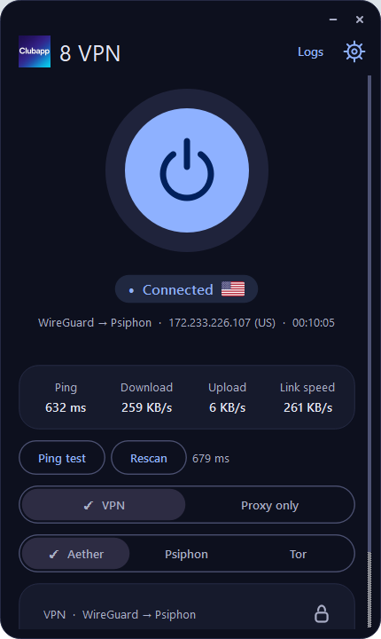
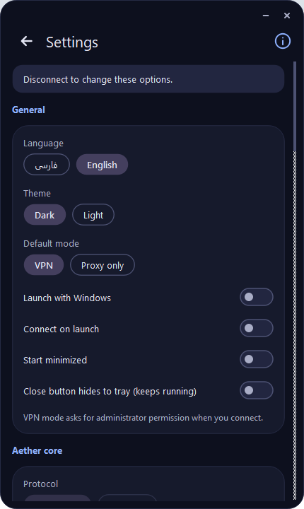
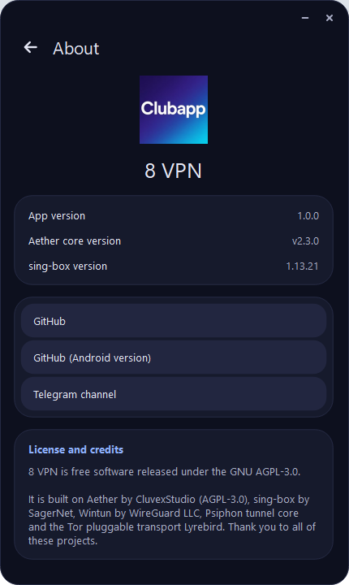

<div align="center">

# 8 VPN for Windows

**A small, light and fast desktop VPN / proxy client built on the Aether core**

English · [فارسی](#-فارسی)

[Releases](../../releases) · [Android version](https://github.com/Mrmmd2004/8vpn) · [Telegram](https://t.me/Clubapp8)

</div>

---

## English

<p align="center">
  
  
  
</p>

### About
8 VPN is the Windows version of the [8vpn Android app](https://github.com/Mrmmd2004/8vpn). It wraps the **Aether** core in a clean, compact interface with one big connect button, live statistics and every route and protocol the core offers.

### Download
Ready-made builds (installer and portable) are in the **[Releases](../../releases)** section. Download, run, connect. Nothing else is needed.

### Features
- **Two modes**
  - **VPN mode**: all apps on the computer go through the tunnel (needs administrator rights).
  - **Proxy only**: sets the Windows system proxy, no virtual network adapter.
- **Routes**: Aether, Aether → Psiphon, Aether → Tor, Psiphon only, Psiphon → Aether, Tor only, Tor → Aether
- **Protocols**: WireGuard, MASQUE (HTTP/3 or HTTP/2), WARP-in-MASQUE (Gool), WARP-in-WARP (Gool classic), MASQUE-in-MASQUE
- **Psiphon**: choose the exit country from a list with flags; Auto or CDN mode. The flag of the exit country is shown next to the connection status.
- **Tor**: bridges Auto / Always / Never
- Live **ping**, ping test, **exit IP and country**, download and upload rate, link speed test, connection timer
- **Smart reconnect** when the core stops or pings fail, and a **Rescan** button to find a new gateway
- Frees a busy port automatically when connecting (can be turned off in Settings)
- Persian (right-to-left) and English, dark and light themes, tray icon
- Options: launch with Windows, connect on launch, start minimized, close button hides to tray, custom SOCKS port and extra core flags

### How it works
```
VPN mode   : apps → Wintun adapter (sing-box) → SOCKS5 127.0.0.1:1819 → Aether → Internet
Proxy mode : Windows system proxy → Aether HTTP 127.0.0.1:1822 → Internet
```

### Cores and components
| Component | What it does here | Link |
|---|---|---|
| **Aether** (v2.3.0) | The main core: WARP / WireGuard / MASQUE tunnels, SOCKS5 and HTTP proxy, Psiphon and Tor routes | https://github.com/CluvexStudio/Aether |
| **sing-box** (1.13.21) | Creates the TUN device and routes all system traffic into Aether in VPN mode | https://github.com/SagerNet/sing-box |
| **Wintun** (0.14.1) | Virtual network adapter driver for Windows | https://www.wintun.net |
| **Psiphon tunnel core** | Circumvention transport used by the Psiphon routes | https://github.com/Psiphon-Labs/psiphon-tunnel-core |
| **Lyrebird** | Tor pluggable transport used by the Tor routes | https://gitlab.torproject.org/tpo/anti-censorship/pluggable-transports/lyrebird |
| **Tor Project** | Tor network | https://www.torproject.org |
| **Python and PyQt6** | The application and its interface | https://www.riverbankcomputing.com/software/pyqt/ |

### Requirements
- Windows, 64-bit
- Administrator permission for VPN mode (the program asks for it when it starts)

### Links
- Android version: https://github.com/Mrmmd2004/8vpn
- Telegram channel: https://t.me/Clubapp8

### License and credits
8 VPN is free software released under the **GNU AGPL-3.0** (see [LICENSE](LICENSE)). It is built on top of the projects listed above. Thank you to all of their authors and contributors.

---

<div dir="rtl" align="right">

## 🇮🇷 فارسی

<p align="center">
  
  
  
</p>

### درباره‌ی برنامه
۸ وی‌پی‌ان نسخه‌ی ویندوز [برنامه‌ی اندروید 8vpn](https://github.com/Mrmmd2004/8vpn) است. هسته‌ی **Aether** را در یک رابط ساده و جمع‌وجور با یک دکمه‌ی بزرگ اتصال، آمار زنده و همه‌ی مسیرها و پروتکل‌های هسته در اختیار شما می‌گذارد.

### دانلود
نسخه‌های آماده (نصب‌کننده و پرتابل) در بخش **[Releases](../../releases)** هستند. دانلود کنید، اجرا کنید و وصل شوید. به هیچ کار دیگری نیاز نیست.

### امکانات
- **دو حالت**
  - **حالت VPN**: همه‌ی برنامه‌های کامپیوتر از تونل عبور می‌کنند (نیاز به دسترسی ادمین).
  - **فقط پروکسی**: پروکسی سیستم ویندوز را تنظیم می‌کند و کارت شبکه‌ی مجازی نمی‌سازد.
- **مسیرها**: Aether، Aether → Psiphon، Aether → Tor، فقط Psiphon، Psiphon → Aether، فقط Tor، Tor → Aether
- **پروتکل‌ها**: WireGuard، MASQUE (با HTTP/3 یا HTTP/2)، WARP-in-MASQUE (Gool)، WARP-in-WARP (Gool classic)، MASQUE-in-MASQUE
- **سایفون**: انتخاب کشور خروجی از یک فهرست پرچم‌دار، حالت Auto یا CDN. پرچم کشور خروجی کنار وضعیت اتصال نمایش داده می‌شود.
- **تور**: پل‌ها (Bridges) در حالت Auto / Always / Never
- **پینگ** زنده، تست پینگ، **آی‌پی و کشور خروجی**، سرعت دانلود و آپلود، تست سرعت لینک، زمان‌سنج اتصال
- **اتصال مجدد هوشمند** هنگام از کار افتادن هسته یا بالا رفتن پینگ، و دکمه‌ی **Rescan** برای پیدا کردن گیت‌وی جدید
- آزاد کردن خودکار پورت اشغال‌شده هنگام اتصال (در تنظیمات قابل خاموش کردن است)
- فارسی (راست‌به‌چپ) و انگلیسی، تم تیره و روشن، آیکون در سینی سیستم
- گزینه‌ها: اجرا همراه ویندوز، اتصال خودکار هنگام اجرا، شروع به‌صورت کوچک‌شده، مخفی شدن در سینی با دکمه‌ی بستن، تغییر پورت SOCKS و فلگ‌های اضافه‌ی هسته

### نحوه‌ی کار
```
VPN mode   : apps → Wintun adapter (sing-box) → SOCKS5 127.0.0.1:1819 → Aether → Internet
Proxy mode : Windows system proxy → Aether HTTP 127.0.0.1:1822 → Internet
```

### هسته‌ها و اجزای استفاده‌شده
| جزء | نقش در برنامه | لینک |
|---|---|---|
| **Aether** (نسخه‌ی 2.3.0) | هسته‌ی اصلی: تونل‌های WARP / WireGuard / MASQUE، پروکسی SOCKS5 و HTTP، مسیرهای Psiphon و Tor | https://github.com/CluvexStudio/Aether |
| **sing-box** (نسخه‌ی 1.13.21) | در حالت VPN دستگاه TUN را می‌سازد و کل ترافیک سیستم را به Aether می‌فرستد | https://github.com/SagerNet/sing-box |
| **Wintun** (نسخه‌ی 0.14.1) | درایور کارت شبکه‌ی مجازی ویندوز | https://www.wintun.net |
| **Psiphon tunnel core** | ترنسپورت دورزدن فیلترینگ برای مسیرهای Psiphon | https://github.com/Psiphon-Labs/psiphon-tunnel-core |
| **Lyrebird** | ترنسپورت Pluggable تور برای مسیرهای Tor | https://gitlab.torproject.org/tpo/anti-censorship/pluggable-transports/lyrebird |
| **Tor Project** | شبکه‌ی تور | https://www.torproject.org |
| **Python و PyQt6** | خود برنامه و رابط کاربری | https://www.riverbankcomputing.com/software/pyqt/ |

### پیش‌نیازها
- ویندوز ۶۴ بیتی
- دسترسی ادمین برای حالت VPN (برنامه هنگام اجرا آن را درخواست می‌کند)

### لینک‌ها
- نسخه‌ی اندروید: https://github.com/Mrmmd2004/8vpn
- کانال تلگرام: https://t.me/Clubapp8

### مجوز و سپاس
۸ وی‌پی‌ان نرم‌افزار آزاد و تحت مجوز **GNU AGPL-3.0** است (فایل [LICENSE](LICENSE) را ببینید). این برنامه روی پروژه‌های بالا ساخته شده است. از همه‌ی سازندگان و مشارکت‌کنندگان آن‌ها سپاسگزاریم.

</div>
